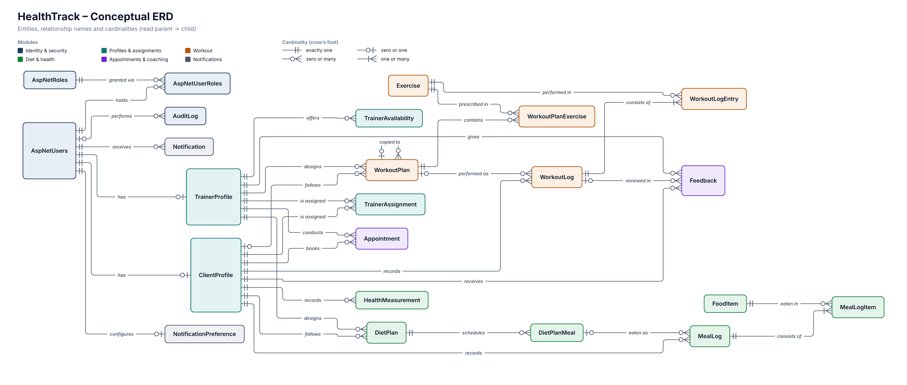
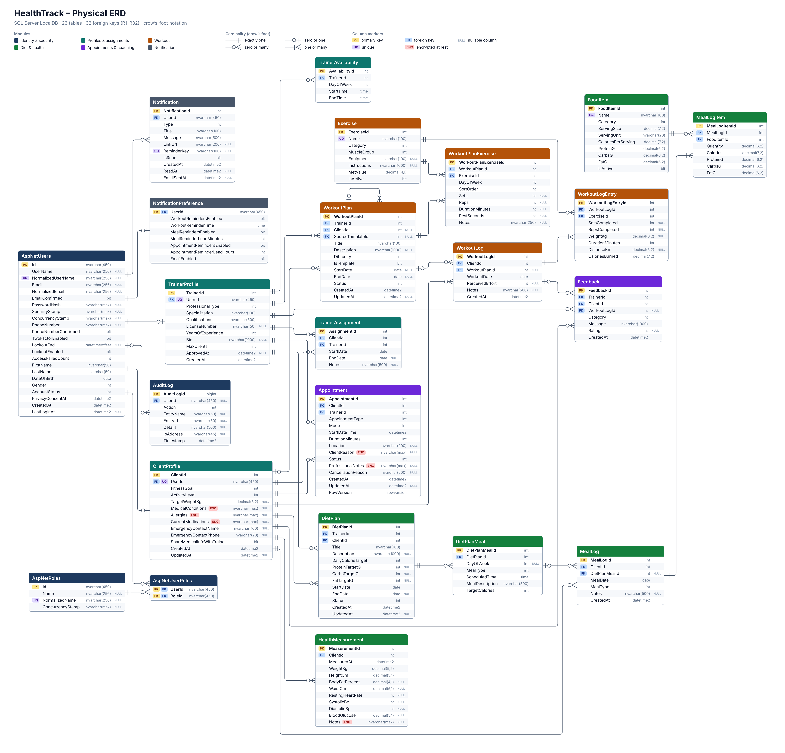
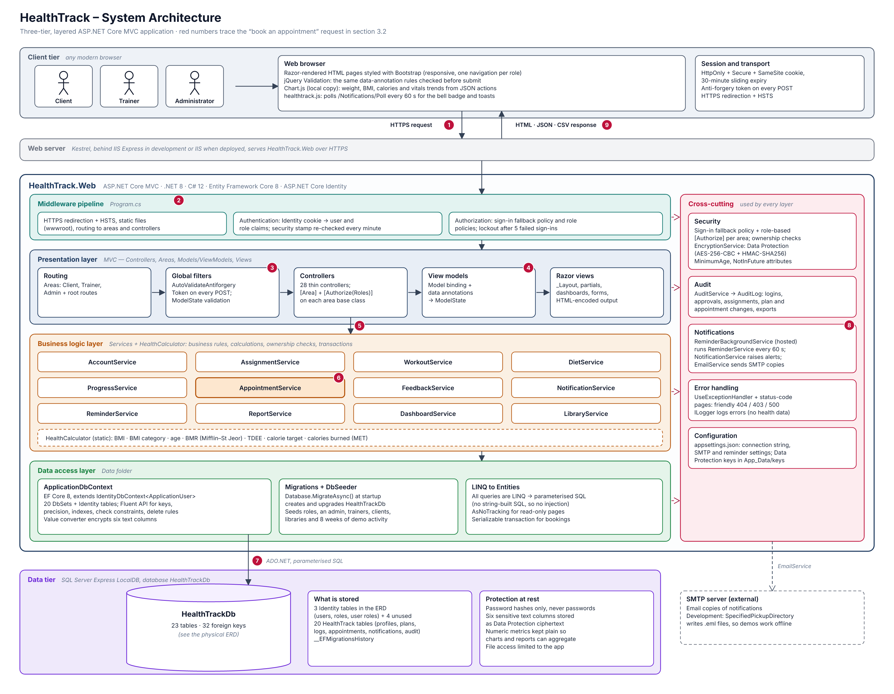
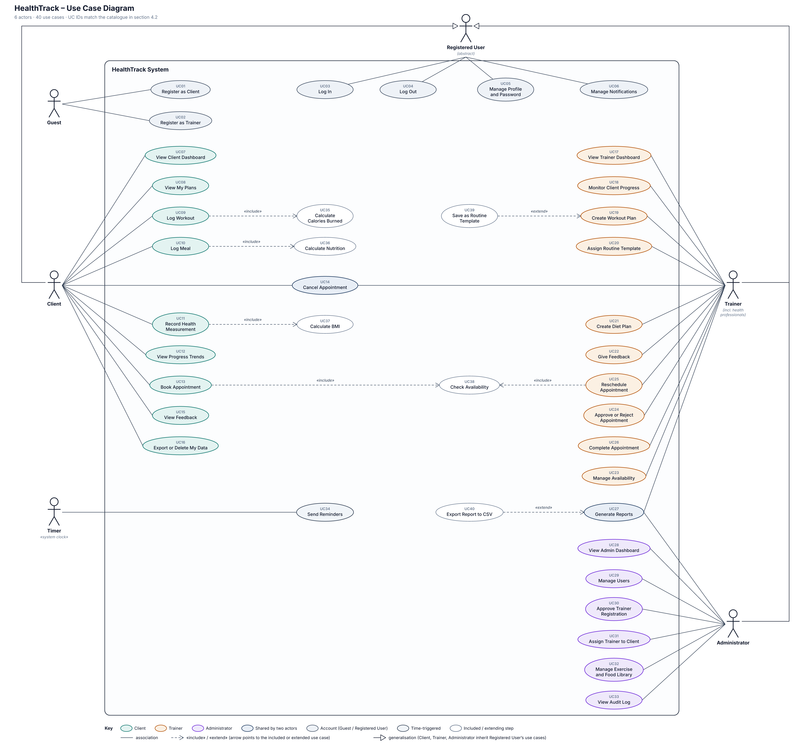
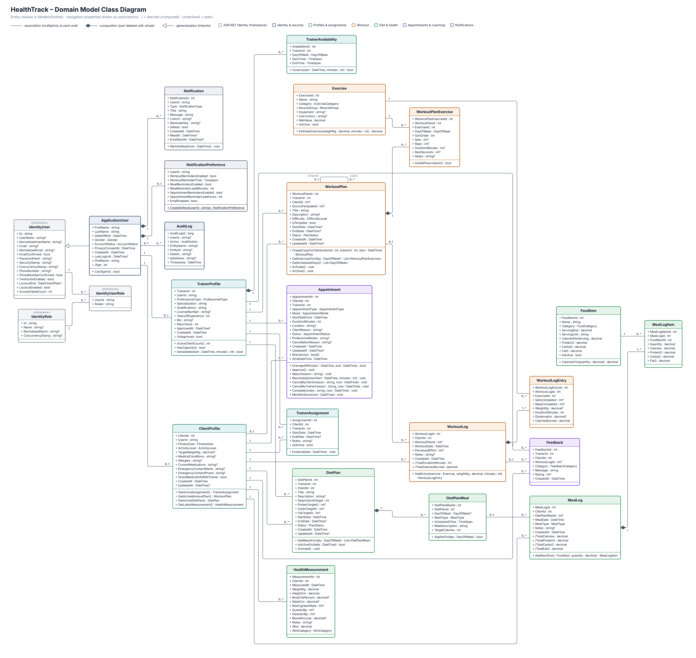
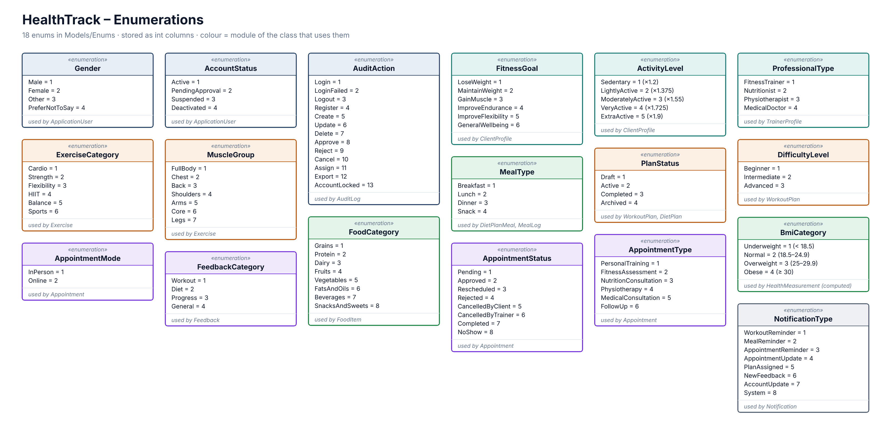
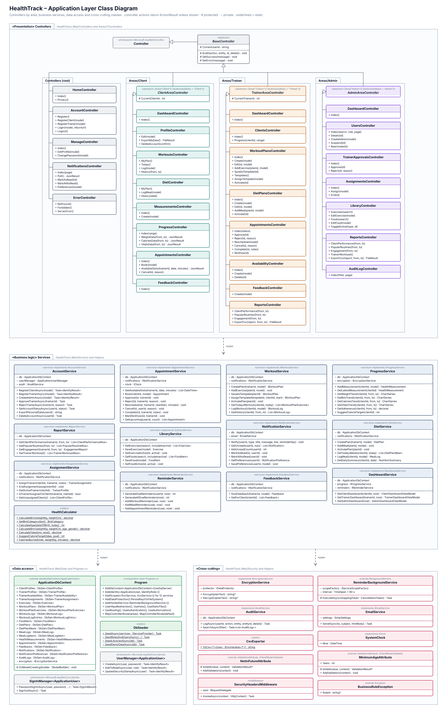

# HealthTrack – System Design & Project Plan

> Exported from the shared design doc "HealthTrack – System Design & Project Plan" on 25 Oct 2026. Diagrams are in `docs/diagrams/` (PNG and SVG).

> Build note: this solution targets .NET 10 (LTS), so wherever this spec says .NET 8, EF Core 8 or C# 12, read .NET 10, EF Core 10 and C# 14 (Visual Studio 2026 required); the web project is `HealthTrack` in `HealthTrack.slnx`, so read `HealthTrack.Web` and `HealthTrack.sln` in 1.13 as `HealthTrack` and `HealthTrack.slnx`.

Oct 25, 2026 · @Kaveesh

## 1. System description

HealthTrack is a role-based ASP.NET Core MVC web application on .NET 8: clients track workouts, meals and health metrics, trainers plan and coach, and administrators run the platform. It covers all eight tasks in the brief plus the security requirement, using one SQL Server database of 23 tables.

### 1.1 Purpose and scope

The system replaces scattered paper logs and spreadsheets with one place where a client's plans, activity, measurements and appointments are linked. Trainers see each assigned client's adherence and trends; administrators see how the platform is used.

In scope:

- Registration and login for Clients, Trainers (approved by an Admin) and Administrators
- A dashboard for each role
- Workout and diet plans written by trainers; workout, meal and measurement logging by clients
- Appointment booking against trainer availability, with an approval workflow
- Trend charts, three management reports and CSV export
- In-app notifications and scheduled reminders, with optional email copies
- Encryption of sensitive health notes, input validation, audit logging and privacy controls

Out of scope: online payments, video calls, wearable-device integration and a native mobile app (the web UI is responsive instead).

### 1.2 Users and roles

The brief's healthcare professionals are Trainer-role users with a professional type: Fitness trainer, Nutritionist, Physiotherapist or Medical doctor. This keeps the three roles the brief names while letting clients book any professional.

| Role | Who | How the account is created | Main responsibilities |
| --- | --- | --- | --- |
| Client | A member tracking their own health | Self-registers; active immediately | Logs workouts, meals and measurements; views plans, trends and feedback; books appointments |
| Trainer | Fitness trainer or healthcare professional | Self-registers with qualifications; stays Pending until an Admin approves | Plans and coaches assigned clients; manages availability and appointments; runs reports |
| Administrator | Platform operator | Seeded on first run, or created by another Admin | Approves trainers, manages users, assigns trainers, maintains exercise and food libraries, monitors usage, runs system-wide reports |

Permissions (Own = the signed-in user's records only; Assigned = clients with an active assignment to that trainer):

| Capability | Client | Trainer | Admin |
| --- | --- | --- | --- |
| Own profile, password, reminder settings | Edit | Edit | Edit |
| Health profile and measurements | Own: create, edit | Assigned: view | Totals only |
| Workout and diet plans | Own: view | Assigned: create, edit, activate | View |
| Workout and meal logs | Own: create, edit | Assigned: view, give feedback | Totals only |
| Appointments | Own: book, cancel | Own: approve, reject, reschedule, cancel, complete | View |
| Trainer availability | View when booking | Own: manage | View |
| Exercise and food libraries | View | View | Create, edit, deactivate |
| Users, trainer approvals, assignments | No | No | Full |
| Reports | No | Assigned clients | All clients |
| Audit log | No | No | View |

### 1.3 Task 1 – Registration and login

- The register page asks the visitor to choose Client or Trainer. Admin accounts can never self-register.
- Common fields: first and last name, email (also the username), password and confirmation, date of birth (16+), gender, phone and privacy-notice consent.
- Clients also enter fitness goal, activity level, height and weight (saved as their first measurement), optional target weight, health conditions, allergies, medications and an emergency contact.
- Trainers also enter professional type, specialisation, qualifications, licence number (required unless Fitness trainer), years of experience and a short bio. The account starts as PendingApproval.
- AccountService creates the user, role, profile and default reminder settings in one database transaction, so a failure never leaves a half-created account.
- Login uses ASP.NET Core Identity: salted PBKDF2 password hashes (HMAC-SHA512, 100,000 iterations), a 15-minute lockout after 5 failed attempts, and a status check that blocks Pending, Suspended and Deactivated accounts.
- After login, users land on their role's dashboard: /Client/Dashboard, /Trainer/Dashboard or /Admin/Dashboard. Logins, failed logins and logouts are written to AuditLog.

### 1.4 Tasks 2–4 – Dashboards

| Dashboard | What it shows | Main source tables |
| --- | --- | --- |
| Client | Latest weight, BMI and BMI category; change since first measurement; today's workout; today's meals with calories eaten vs target; calories burned this week; next 3 appointments; latest feedback; unread notifications | HealthMeasurement, WorkoutPlan, WorkoutLog, DietPlan, MealLog, Appointment, Feedback, Notification |
| Trainer | Assigned clients with last activity, weekly adherence % and weight change; clients inactive 7+ days flagged; pending appointment requests; today's schedule; quick actions (create plan, assign routine, give feedback) | TrainerAssignment, WorkoutLog, MealLog, HealthMeasurement, Appointment |
| Administrator | Users by role and status; new registrations this month; active users in the last 7 days; trainers awaiting approval; unassigned clients; trainer workload vs capacity; logins per day for 14 days; appointments by status; recent audit events | AspNetUsers, TrainerProfile, TrainerAssignment, Appointment, AuditLog |

DashboardService builds one view model per role with read-only (AsNoTracking) queries, so each dashboard loads in a single request.

### 1.5 Task 5 – Workout and diet management

**Workout plans**

- Trainers build a plan from the Exercise library. Each line sets the weekday, order, sets × reps or a duration, rest time and notes.
- A plan can be saved as a routine template (IsTemplate = true, no client). Assigning a template copies it and its exercises to a client and records SourceTemplateId.
- Plans move Draft → Active → Completed or Archived. Activating a plan completes the client's previous active plan, so each client has one active workout plan.
- Clients log a session from Today's workout, where the plan's exercises are pre-filled to tick off and adjust, or log a free workout.
- Each log entry stores duration plus sets, reps, load or distance. The system calculates calories burned from the exercise's MET value and the client's latest weight.

**Diet plans and measurements**

- Trainers set a daily calorie target, pre-filled from the client's TDEE and goal, plus optional protein, carb and fat targets.
- Each plan meal has a meal type, scheduled time, description and target calories, for every day or one weekday. The scheduled time drives meal reminders.
- Clients log a meal by picking food items and quantities. Calories and macros are calculated from the food library, stored with the log and compared with the plan.
- Clients record measurements: weight and height (required), body fat, waist, resting heart rate, blood pressure, blood glucose and encrypted notes. BMI is calculated, never typed.

### 1.6 Task 6 – Appointment system

- Trainers publish weekly availability windows, for example Monday 09:00–12:00.
- Clients pick a professional, type (personal training, fitness assessment, nutrition consultation, physiotherapy, medical consultation, follow-up), mode (in person or online), date and length (30, 45, 60 or 90 minutes). Only free start times are offered.
- AppointmentService checks the start is 2 hours to 60 days ahead, inside an availability window, and overlaps no open appointment of the trainer or client. The check repeats inside a serializable transaction at save time, so two clients cannot grab the same slot.
- New bookings are Pending and the trainer is notified. The trainer approves, rejects (reason required), reschedules or cancels (reason required); clients can cancel until 2 hours before the start.
- After the start time the trainer marks it Completed, with encrypted consultation notes, or No-show. Every change notifies the other party, and a RowVersion column rejects clashing simultaneous edits.

**Appointment lifecycle** (the diagram in the shared doc, as a table):

| Method | Allowed from | New status | Who | Extra rule |
| --- | --- | --- | --- | --- |
| (booking) | – | Pending | Client | BR-15 slot checks |
| Approve() | Pending | Approved | Trainer | |
| Reject(reason) | Pending | Rejected | Trainer | Reason required |
| Reschedule(newStart, minutes) | Approved, Rescheduled | Rescheduled | Trainer | New slot passes the BR-15 checks |
| CancelByClient(reason, now) | Pending, Approved, Rescheduled | CancelledByClient | Client | Until 2 hours before the start |
| CancelByTrainer(reason, now) | Approved, Rescheduled | CancelledByTrainer | Trainer | Reason required; before the start |
| Complete(notes, now) | Approved, Rescheduled | Completed | Trainer | After the start; encrypted notes |
| MarkNoShow(now) | Approved, Rescheduled | NoShow | Trainer | After the start |

Approved and Rescheduled are the confirmed (open) states.

Only Pending, Approved and Rescheduled appointments can still change; the five coloured states are final.

### 1.7 Task 7 – Progress tracking and analytics

- Clients see line charts of weight and BMI (target weight as a reference line), weekly bars of calories burned and calories eaten vs target, and heart-rate and blood-pressure trends. Ranges: 4 weeks, 3 months or custom.
- Charts use Chart.js fed by JSON actions on ProgressController, which return date–value pairs from ProgressService.
- Trainers open the same progress page for any assigned client, plus adherence figures.
- Three reports, each with a date range, on-screen table and chart, CSV export and print view. Trainers see their assigned clients; admins see everyone.
  - Client performance: start vs latest weight and BMI, workouts completed, workout adherence %, average daily calories vs target, calories burned, appointments attended.
  - Popular routines: templates ranked by clients assigned, active plans and average adherence; top 10 exercises by times logged; share of each exercise category.
  - Engagement: active clients (any log in the last 7 days), logs per client per week, logins per day, appointments by status, registrations per month; admins also get trainer workload.

### 1.8 Task 8 – Notifications and reminders

- Event notifications are created at once: plan assigned; appointment requested, approved, rejected, rescheduled or cancelled; new feedback; trainer approved; trainer assigned.
- ReminderService creates three kinds of reminder:
  - Workout: today is a training day in the active plan, the user's reminder time has passed (default 07:00) and nothing is logged yet.
  - Meal: a planned meal starts within the lead time (default 15 minutes) and is not logged yet.
  - Appointment: an approved or rescheduled appointment starts within the lead time (default 24 hours); both client and trainer are reminded.
- Each reminder carries a ReminderKey such as MEAL-42-20261025 with a unique index, so it is created once however often the check runs.
- ReminderBackgroundService, a hosted service, calls ReminderService.GenerateAllDueReminders(now) every 60 seconds, so reminders and email copies go out even when nobody is signed in.
- The bell icon in the layout polls /Notifications/Poll by AJAX every 60 seconds for the unread count and newest items, shown as a toast; the poll also runs GenerateDueReminders(userId, now) for the signed-in user.
- Users switch each reminder type on or off and set times, lead times and email copies. Email uses the SMTP settings in appsettings.json; in development it writes .eml files to a pickup folder, so the demo works offline.

### 1.9 Security and data protection

| Threat or requirement | Control |
| --- | --- |
| Stolen passwords | ASP.NET Core Identity's built-in hasher: PBKDF2 with HMAC-SHA512, 100,000 iterations and a random salt; strong password policy |
| Password guessing | Lockout for 15 minutes after 5 failed attempts; failed logins audited |
| Unauthorised access | A fallback policy requires sign-in on every page; role-based \[Authorize\] on each area's base controller; ownership checks in services (clients see only their data, trainers only assigned clients) |
| Data in transit | HTTPS redirection and HSTS middleware; Secure, HttpOnly, SameSite auth cookie with 30-minute sliding expiry |
| Data at rest | EncryptionService (ASP.NET Core Data Protection: AES-256-CBC with HMAC-SHA256, keys stored in App\_Data/keys) encrypts health conditions, allergies, medications, measurement notes, appointment reasons and consultation notes through an EF Core value converter |
| SQL injection and XSS | EF Core LINQ (parameterised SQL); Razor HTML encoding; no Html.Raw on user input; Content-Security-Policy header |
| CSRF and over-posting | Global AutoValidateAntiforgeryToken filter checks every POST, including AJAX (token sent as a header); view models instead of entities in forms |
| Invalid input | Data annotations plus custom \[MinimumAge\] and \[NotInFuture\] attributes, checked in the browser and on the server; business rules in services; friendly error pages |
| Accountability | AuditLog records logins, registrations, approvals, assignments, plan and appointment changes, exports and deletions, never health values or passwords |
| Privacy (GDPR-style principles) | Consent at registration; privacy notice; data minimisation; clients decide whether trainers see medical details; admins see totals, not clinical notes; Download my data (JSON) and Delete my account |

### 1.10 Calculations

```latex
\text{BMI} = \frac{\text{weight in kg}}{(\text{height in m})^2}
```

BMI categories (WHO, adults): under 18.5 Underweight; 18.5–24.9 Normal; 25.0–29.9 Overweight; 30.0 and over Obese.

```latex
\text{BMR} = 10W + 6.25H - 5A + s \qquad \text{TDEE} = \text{BMR} \times \text{activity factor}
```

Mifflin–St Jeor: W = weight (kg), H = height (cm), A = age (years); s = +5 male, −161 female, −78 otherwise. Activity factors: 1.2, 1.375, 1.55, 1.725, 1.9 from Sedentary to Extra active. Suggested calorie target: TDEE − 500 to lose weight, TDEE + 300 to gain muscle, else TDEE; never below 1,200 kcal.

```latex
\text{kcal burned} = \text{MET} \times W \times \frac{\text{minutes}}{60}
```

```latex
\text{workout adherence \%} = \frac{\text{scheduled days with a logged session}}{\text{days scheduled by the plan}} \times 100
```

Food: item calories = quantity × CaloriesPerServing, and the same for protein, carbs and fat; daily intake is the sum of the day's items.

### 1.11 Business rules

| ID | Rule | Enforced in |
| --- | --- | --- |
| BR-01 | Email is the username and is unique; passwords need 8+ characters with upper case, lower case, a digit and a symbol | Identity validators |
| BR-02 | Users must be 16 or older and accept the privacy notice | \[MinimumAge\], consent checkbox |
| BR-03 | Trainers start PendingApproval and cannot sign in until approved; a licence number is required unless Fitness trainer | AccountService, view model |
| BR-04 | Admins are seeded or created by an Admin; no Admin can suspend themselves or the last active Admin | AccountService |
| BR-05 | One role per user; suspended users are signed out at the next security-stamp check (within 1 minute) | AccountService, Identity |
| BR-06 | A client has at most one active trainer assignment; assigning a new trainer ends the old one | AssignmentService |
| BR-07 | A trainer's active clients cannot exceed MaxClients; only approved, active trainers can be assigned | AssignmentService |
| BR-08 | Trainers reach only clients actively assigned to them; other professionals see only their own appointments | Service ownership checks |
| BR-09 | One active workout plan and one active diet plan per client; activating a new plan completes the old one | WorkoutService, DietService |
| BR-10 | A plan needs at least one exercise or meal before activation; EndDate is on or after StartDate | Services, view models |
| BR-11 | Every plan exercise has sets and reps, or a duration | WorkoutPlanExercise.IsValidPrescription |
| BR-12 | Assigning a template copies it; later edits never change the template | WorkoutPlan.CreateCopyForClient |
| BR-13 | Logs and measurements cannot be future-dated; a workout log needs 1+ entries, a meal log 1+ items | \[NotInFuture\], services |
| BR-14 | Calories, macros and BMI are calculated by the system, never typed | HealthCalculator |
| BR-15 | Bookings are 2 hours to 60 days ahead, inside an availability window, with no overlap for trainer or client | AppointmentService (serializable transaction) |
| BR-16 | Only the lifecycle transitions drawn in 1.6 are allowed; rejections and trainer cancellations need a reason | Appointment methods |
| BR-17 | Clients cancel until 2 hours before start; Completed and No-show only after the start time | Appointment methods |
| BR-18 | Every appointment status change notifies the other party | AppointmentService, NotificationService |
| BR-19 | Each reminder is created once and follows the user's preferences | ReminderService, unique ReminderKey |
| BR-20 | Sensitive free-text health fields are encrypted at rest; numeric metrics stay plain for analytics | EncryptionService |
| BR-21 | Exercises, foods and used plans are deactivated or archived, never hard-deleted | Services (IsActive, Status) |
| BR-22 | Clients can export their data and delete their account; deletion anonymises the user and removes health records | AccountService |

### 1.12 Non-functional requirements

- Usability: responsive Bootstrap layout, role-specific navigation, inline validation messages, confirmation before destructive actions.
- Performance: lists paged at 20 rows; foreign keys and date columns indexed; read queries use AsNoTracking; dashboards load in one request.
- Reliability: multi-table writes run in transactions; optimistic concurrency on appointments; global error handling with friendly pages.
- Maintainability: controllers → services → DbContext layering, service interfaces, consistent naming, XML comments on public methods, MSTest unit tests.
- Portability: .NET 8 (LTS) and LocalDB, so it opens and runs in a standard Visual Studio 2022 (17.8 or later) or 2026 install; migrations and seeding run on first start.

### 1.13 Technology stack and solution structure

| Concern | Choice | Reason |
| --- | --- | --- |
| Framework | ASP.NET Core MVC on .NET 8 (LTS), C# 12 | Meets the brief's ASP.NET MVC + C# requirement; opens in Visual Studio 2022 (17.8+) and 2026, whereas .NET 10 needs 2026 |
| Data access | Entity Framework Core 8 with migrations | Classes map to tables; migrations and seeding run at startup |
| Identity | ASP.NET Core Identity with roles | Password hashing, lockout, security stamps and cookie sign-in built in |
| Database | SQL Server Express LocalDB (HealthTrackDb) | Installed with the ASP.NET workload; no server setup |
| UI | Razor views, Bootstrap 5, jQuery Validation, Chart.js (local copy) | Responsive, client-side validation, charts work offline |
| Background work | Hosted service (BackgroundService) | Reminders created every minute with no extra tools |
| Email | System.Net.Mail SmtpClient, pickup folder in development | Demonstrable without internet access |
| Testing | MSTest with EF Core InMemory | Unit tests for calculations, appointment rules and reminders |

```
HealthTrack.sln
├── HealthTrack.Web/
│   ├── Program.cs         DI registrations, Identity options, middleware pipeline
│   ├── appsettings.json   connection string, SMTP and reminder settings
│   ├── Areas/             Admin, Trainer, Client (controllers + views per role)
│   ├── Controllers/       Home, Account, Manage, Notifications, Error
│   ├── Models/Entities/   ApplicationUser + 20 domain classes
│   ├── Models/Enums/      18 enums
│   ├── Models/ViewModels/
│   ├── Data/              ApplicationDbContext, Migrations, DbSeeder
│   ├── Services/          interfaces + implementations, ReminderBackgroundService
│   ├── Security/          EncryptionService, validation attributes, SecurityHeadersMiddleware
│   ├── Helpers/           HealthCalculator, CsvExporter, IClock
│   ├── Views/             shared layout, partials, error pages
│   └── wwwroot/           css, js (healthtrack.js), lib (Bootstrap, jQuery, Chart.js)
└── HealthTrack.Tests/     MSTest
```

## 2. ERD specification

The database has 23 tables (3 ASP.NET Identity tables and 20 HealthTrack tables) joined by 32 foreign keys, normalised to third normal form. Entity Framework Core migrations generate everything below from the classes in section 5.

### 2.1 Entity catalogue

| # | Table | Module | Holds |
| --- | --- | --- | --- |
| 1 | AspNetUsers | Identity | Every login account (class ApplicationUser) |
| 2 | AspNetRoles | Identity | The roles Admin, Trainer and Client |
| 3 | AspNetUserRoles | Identity | Which role each user has |
| 4 | ClientProfile | Profiles | A client's goal, activity level and encrypted medical details |
| 5 | TrainerProfile | Profiles | A professional's type, qualifications, capacity and approval |
| 6 | TrainerAvailability | Profiles | Weekly time windows in which a trainer accepts bookings |
| 7 | TrainerAssignment | Profiles | Which trainer coaches which client, with history |
| 8 | Exercise | Workout | Exercise library with MET values |
| 9 | WorkoutPlan | Workout | Client workout plans and reusable routine templates |
| 10 | WorkoutPlanExercise | Workout | Exercises prescribed per weekday in a plan |
| 11 | WorkoutLog | Workout | A workout session done by a client |
| 12 | WorkoutLogEntry | Workout | Each exercise done in a session, with calories |
| 13 | FoodItem | Diet | Food library with nutrition per serving |
| 14 | DietPlan | Diet | A client's daily calorie and macro targets |
| 15 | DietPlanMeal | Diet | Scheduled meals within a diet plan |
| 16 | MealLog | Diet | A meal eaten by a client |
| 17 | MealLogItem | Diet | Each food in a logged meal, with nutrition |
| 18 | HealthMeasurement | Health | Weight, height and vital signs over time |
| 19 | Appointment | Appointments | Consultations and their status |
| 20 | Feedback | Coaching | Trainer comments to clients |
| 21 | Notification | Notifications | In-app messages and reminders |
| 22 | NotificationPreference | Notifications | Each user's reminder settings |
| 23 | AuditLog | Security | Who did what, when and from where |

### 2.2 ERD diagrams



*Diagram file: `docs/diagrams/02-erd-conceptual.png` (text-readable copy: `02-erd-conceptual.svg`)*

ClientProfile and TrainerProfile are the hubs: every plan, log, appointment and piece of feedback hangs off one or both of them.



*Diagram file: `docs/diagrams/03-erd-physical.png` (text-readable copy: `03-erd-physical.svg`)*

The physical ERD shows every column with its SQL Server type; badges mark primary, foreign and unique keys, encrypted columns and nullable columns.

### 2.3 Identity tables

Key: PK primary key, FK foreign key, UQ unique. Null = whether the column allows NULL.

**AspNetUsers** (class ApplicationUser, extends IdentityUser)

| Column | Data type | Key | Null | Description and rules |
| --- | --- | --- | --- | --- |
| Id | nvarchar(450) | PK | No | GUID string generated by Identity |
| UserName | nvarchar(256) |  | Yes | Set to the email address |
| NormalizedUserName | nvarchar(256) | UQ | Yes | Upper-case UserName; unique index UserNameIndex |
| Email | nvarchar(256) |  | Yes | Required and unique in the app (RequireUniqueEmail) |
| NormalizedEmail | nvarchar(256) |  | Yes | Upper-case Email; index EmailIndex |
| EmailConfirmed | bit |  | No | Identity flag |
| PasswordHash | nvarchar(max) |  | Yes | Salted PBKDF2 hash; plain passwords are never stored |
| SecurityStamp | nvarchar(max) |  | Yes | Changes on password, role or status change, which signs out old cookies |
| ConcurrencyStamp | nvarchar(max) |  | Yes | Concurrency token used by Identity |
| PhoneNumber | nvarchar(max) |  | Yes | Validated phone format |
| PhoneNumberConfirmed | bit |  | No | Identity flag |
| TwoFactorEnabled | bit |  | No | Identity flag (not used, false) |
| LockoutEnd | datetimeoffset |  | Yes | Set 15 minutes ahead after 5 failed logins |
| LockoutEnabled | bit |  | No | True for every user |
| AccessFailedCount | int |  | No | Failed logins since the last success |
| FirstName | nvarchar(50) |  | No | Letters, spaces and hyphens |
| LastName | nvarchar(50) |  | No | Letters, spaces and hyphens |
| DateOfBirth | date |  | No | Age 16 or over |
| Gender | int |  | No | Gender enum |
| AccountStatus | int |  | No | AccountStatus enum |
| PrivacyConsentAt | datetime2 |  | No | When the privacy notice was accepted |
| CreatedAt | datetime2 |  | No | Registration time |
| LastLoginAt | datetime2 |  | Yes | Updated on each successful login |

**AspNetRoles** (class IdentityRole)

| Column | Data type | Key | Null | Description and rules |
| --- | --- | --- | --- | --- |
| Id | nvarchar(450) | PK | No | GUID string |
| Name | nvarchar(256) |  | Yes | Admin, Trainer or Client |
| NormalizedName | nvarchar(256) | UQ | Yes | Upper-case Name; unique index RoleNameIndex |
| ConcurrencyStamp | nvarchar(max) |  | Yes | Concurrency token used by Identity |

**AspNetUserRoles** (class IdentityUserRole)

| Column | Data type | Key | Null | Description and rules |
| --- | --- | --- | --- | --- |
| UserId | nvarchar(450) | PK, FK | No | References AspNetUsers.Id; cascade delete |
| RoleId | nvarchar(450) | PK, FK | No | References AspNetRoles.Id; cascade delete |

Identity also creates AspNetUserClaims, AspNetUserLogins, AspNetUserTokens and AspNetRoleClaims. HealthTrack does not use them, so they are left out of the ERD, as is EF Core's \_\_EFMigrationsHistory.

### 2.4 Profiles and assignments

**ClientProfile**

| Column | Data type | Key | Null | Description and rules |
| --- | --- | --- | --- | --- |
| ClientId | int | PK | No | Identity (auto-number) |
| UserId | nvarchar(450) | FK, UQ | No | References AspNetUsers.Id; unique, so one profile per user |
| FitnessGoal | int |  | No | FitnessGoal enum |
| ActivityLevel | int |  | No | ActivityLevel enum; sets the TDEE factor |
| TargetWeightKg | decimal(5,2) |  | Yes | 30–300 |
| MedicalConditions | nvarchar(max) |  | Yes | Encrypted |
| Allergies | nvarchar(max) |  | Yes | Encrypted |
| CurrentMedications | nvarchar(max) |  | Yes | Encrypted |
| EmergencyContactName | nvarchar(100) |  | Yes |  |
| EmergencyContactPhone | nvarchar(20) |  | Yes | Phone format |
| ShareMedicalInfoWithTrainer | bit |  | No | Default 1; when 0, trainers cannot see the three encrypted fields |
| CreatedAt | datetime2 |  | No |  |
| UpdatedAt | datetime2 |  | Yes |  |

**TrainerProfile**

| Column | Data type | Key | Null | Description and rules |
| --- | --- | --- | --- | --- |
| TrainerId | int | PK | No | Identity |
| UserId | nvarchar(450) | FK, UQ | No | References AspNetUsers.Id; one profile per user |
| ProfessionalType | int |  | No | ProfessionalType enum |
| Specialization | nvarchar(100) |  | No | For example, strength and conditioning |
| Qualifications | nvarchar(500) |  | No | Certificates and degrees |
| LicenseNumber | nvarchar(50) |  | Yes | Required unless ProfessionalType is FitnessTrainer |
| YearsOfExperience | int |  | No | 0–60 |
| Bio | nvarchar(1000) |  | Yes | Shown to clients when booking |
| MaxClients | int |  | No | Default 20; 1–100 |
| ApprovedAt | datetime2 |  | Yes | Null until an Admin approves |
| CreatedAt | datetime2 |  | No |  |

**TrainerAvailability**

| Column | Data type | Key | Null | Description and rules |
| --- | --- | --- | --- | --- |
| AvailabilityId | int | PK | No | Identity |
| TrainerId | int | FK | No | References TrainerProfile.TrainerId; cascade delete |
| DayOfWeek | int |  | No | 0 = Sunday to 6 = Saturday (System.DayOfWeek) |
| StartTime | time |  | No | Unique with TrainerId and DayOfWeek |
| EndTime | time |  | No | Later than StartTime; windows on one day cannot overlap |

**TrainerAssignment**

| Column | Data type | Key | Null | Description and rules |
| --- | --- | --- | --- | --- |
| AssignmentId | int | PK | No | Identity |
| ClientId | int | FK | No | References ClientProfile.ClientId |
| TrainerId | int | FK | No | References TrainerProfile.TrainerId |
| StartDate | date |  | No |  |
| EndDate | date |  | Yes | Null = active; at most one active row per client |
| Notes | nvarchar(500) |  | Yes | Admin's note on the match |

### 2.5 Workout module

**Exercise**

| Column | Data type | Key | Null | Description and rules |
| --- | --- | --- | --- | --- |
| ExerciseId | int | PK | No | Identity |
| Name | nvarchar(100) | UQ | No |  |
| Category | int |  | No | ExerciseCategory enum |
| MuscleGroup | int |  | No | MuscleGroup enum |
| Equipment | nvarchar(100) |  | Yes | Empty = bodyweight |
| Instructions | nvarchar(1000) |  | Yes |  |
| MetValue | decimal(4,1) |  | No | 1.0–20.0; used to calculate calories burned |
| IsActive | bit |  | No | Default 1; inactive exercises are hidden, never deleted |

**WorkoutPlan**

| Column | Data type | Key | Null | Description and rules |
| --- | --- | --- | --- | --- |
| WorkoutPlanId | int | PK | No | Identity |
| TrainerId | int | FK | No | References TrainerProfile; the author |
| ClientId | int | FK | Yes | References ClientProfile; null for templates |
| SourceTemplateId | int | FK | Yes | References WorkoutPlan.WorkoutPlanId (self); the template it was copied from |
| Title | nvarchar(100) |  | No |  |
| Description | nvarchar(1000) |  | Yes | Goal and guidance |
| Difficulty | int |  | No | DifficultyLevel enum |
| IsTemplate | bit |  | No | Check: IsTemplate = 1 exactly when ClientId is null |
| StartDate | date |  | Yes | Required for client plans |
| EndDate | date |  | Yes | On or after StartDate |
| Status | int |  | No | PlanStatus enum |
| CreatedAt | datetime2 |  | No |  |
| UpdatedAt | datetime2 |  | Yes |  |

**WorkoutPlanExercise** (resolves WorkoutPlan many-to-many Exercise)

| Column | Data type | Key | Null | Description and rules |
| --- | --- | --- | --- | --- |
| WorkoutPlanExerciseId | int | PK | No | Identity |
| WorkoutPlanId | int | FK | No | References WorkoutPlan; cascade delete |
| ExerciseId | int | FK | No | References Exercise |
| DayOfWeek | int |  | No | 0–6 |
| SortOrder | int |  | No | Order within the day |
| Sets | int |  | Yes | 1–20 |
| Reps | int |  | Yes | 1–100 |
| DurationMinutes | int |  | Yes | 1–300; Sets and Reps, or DurationMinutes, required |
| RestSeconds | int |  | Yes | 0–600 |
| Notes | nvarchar(250) |  | Yes | Trainer's coaching cue |

**WorkoutLog**

| Column | Data type | Key | Null | Description and rules |
| --- | --- | --- | --- | --- |
| WorkoutLogId | int | PK | No | Identity |
| ClientId | int | FK | No | References ClientProfile |
| WorkoutPlanId | int | FK | Yes | References WorkoutPlan; null = free workout |
| WorkoutDate | date |  | No | Not in the future |
| PerceivedEffort | int |  | Yes | Rating of perceived exertion, 1–10 |
| Notes | nvarchar(500) |  | Yes |  |
| CreatedAt | datetime2 |  | No |  |

Session totals (duration, calories) are computed from the entries, not stored.

**WorkoutLogEntry** (resolves WorkoutLog many-to-many Exercise)

| Column | Data type | Key | Null | Description and rules |
| --- | --- | --- | --- | --- |
| WorkoutLogEntryId | int | PK | No | Identity |
| WorkoutLogId | int | FK | No | References WorkoutLog; cascade delete |
| ExerciseId | int | FK | No | References Exercise |
| SetsCompleted | int |  | Yes |  |
| RepsCompleted | int |  | Yes | Reps per set |
| WeightKg | decimal(6,2) |  | Yes | Load lifted |
| DurationMinutes | int |  | No | 1–300 |
| DistanceKm | decimal(6,2) |  | Yes | For cardio |
| CaloriesBurned | decimal(7,2) |  | No | MET × body weight × hours, stored as a snapshot |

### 2.6 Diet and health module

**FoodItem**

| Column | Data type | Key | Null | Description and rules |
| --- | --- | --- | --- | --- |
| FoodItemId | int | PK | No | Identity |
| Name | nvarchar(100) | UQ | No |  |
| Category | int |  | No | FoodCategory enum |
| ServingSize | decimal(7,2) |  | No | For example, 100 |
| ServingUnit | nvarchar(20) |  | No | g, ml, piece, cup, slice or tbsp |
| CaloriesPerServing | decimal(7,2) |  | No | kcal, 0–2,000 |
| ProteinG | decimal(6,2) |  | No | Grams per serving |
| CarbsG | decimal(6,2) |  | No | Grams per serving |
| FatG | decimal(6,2) |  | No | Grams per serving |
| IsActive | bit |  | No | Default 1 |

**DietPlan**

| Column | Data type | Key | Null | Description and rules |
| --- | --- | --- | --- | --- |
| DietPlanId | int | PK | No | Identity |
| TrainerId | int | FK | No | References TrainerProfile |
| ClientId | int | FK | No | References ClientProfile |
| Title | nvarchar(100) |  | No |  |
| Description | nvarchar(1000) |  | Yes |  |
| DailyCalorieTarget | int |  | No | 1,200–5,000 kcal |
| ProteinTargetG | int |  | Yes |  |
| CarbsTargetG | int |  | Yes |  |
| FatTargetG | int |  | Yes |  |
| StartDate | date |  | No |  |
| EndDate | date |  | Yes | On or after StartDate |
| Status | int |  | No | PlanStatus enum |
| CreatedAt | datetime2 |  | No |  |
| UpdatedAt | datetime2 |  | Yes |  |

**DietPlanMeal**

| Column | Data type | Key | Null | Description and rules |
| --- | --- | --- | --- | --- |
| DietPlanMealId | int | PK | No | Identity |
| DietPlanId | int | FK | No | References DietPlan; cascade delete |
| DayOfWeek | int |  | Yes | Null = every day |
| MealType | int |  | No | MealType enum |
| ScheduledTime | time |  | No | Drives meal reminders |
| MealDescription | nvarchar(500) |  | No | For example, oats 50 g, banana, 200 ml low-fat milk |
| TargetCalories | int |  | No | 50–2,000 |

**MealLog**

| Column | Data type | Key | Null | Description and rules |
| --- | --- | --- | --- | --- |
| MealLogId | int | PK | No | Identity |
| ClientId | int | FK | No | References ClientProfile |
| DietPlanMealId | int | FK | Yes | References DietPlanMeal; null = unplanned meal |
| MealDate | date |  | No | Not in the future |
| MealType | int |  | No | MealType enum |
| Notes | nvarchar(500) |  | Yes |  |
| CreatedAt | datetime2 |  | No |  |

**MealLogItem** (resolves MealLog many-to-many FoodItem)

| Column | Data type | Key | Null | Description and rules |
| --- | --- | --- | --- | --- |
| MealLogItemId | int | PK | No | Identity |
| MealLogId | int | FK | No | References MealLog; cascade delete |
| FoodItemId | int | FK | No | References FoodItem |
| Quantity | decimal(6,2) |  | No | Servings, 0.25–20 |
| Calories | decimal(7,2) |  | No | Snapshot: Quantity × CaloriesPerServing |
| ProteinG | decimal(6,2) |  | No | Snapshot |
| CarbsG | decimal(6,2) |  | No | Snapshot |
| FatG | decimal(6,2) |  | No | Snapshot |

**HealthMeasurement**

| Column | Data type | Key | Null | Description and rules |
| --- | --- | --- | --- | --- |
| MeasurementId | int | PK | No | Identity |
| ClientId | int | FK | No | References ClientProfile |
| MeasuredAt | datetime2 |  | No | Not in the future |
| WeightKg | decimal(5,2) |  | No | 20–350 |
| HeightCm | decimal(5,1) |  | No | 50–250; pre-filled from the last reading |
| BodyFatPercent | decimal(4,1) |  | Yes | 2–70 |
| WaistCm | decimal(5,1) |  | Yes | 30–250 |
| RestingHeartRate | int |  | Yes | 30–220 bpm |
| SystolicBp | int |  | Yes | 70–250 mmHg |
| DiastolicBp | int |  | Yes | 40–150 mmHg; lower than systolic |
| BloodGlucose | decimal(5,1) |  | Yes | 20–600 mg/dL |
| Notes | nvarchar(max) |  | Yes | Encrypted |

BMI and BMI category are computed properties of the class, not columns.

### 2.7 Appointments and feedback

**Appointment**

| Column | Data type | Key | Null | Description and rules |
| --- | --- | --- | --- | --- |
| AppointmentId | int | PK | No | Identity |
| ClientId | int | FK | No | References ClientProfile |
| TrainerId | int | FK | No | References TrainerProfile (the professional) |
| AppointmentType | int |  | No | AppointmentType enum |
| Mode | int |  | No | AppointmentMode enum |
| StartDateTime | datetime2 |  | No | 2 hours to 60 days ahead when booked |
| DurationMinutes | int |  | No | 30, 45, 60 or 90 |
| Location | nvarchar(200) |  | Yes | Room, or meeting link when online |
| ClientReason | nvarchar(max) |  | Yes | Encrypted |
| Status | int |  | No | AppointmentStatus enum |
| ProfessionalNotes | nvarchar(max) |  | Yes | Encrypted; written on completion |
| CancellationReason | nvarchar(500) |  | Yes | Also holds a rejection reason |
| CreatedAt | datetime2 |  | No |  |
| UpdatedAt | datetime2 |  | Yes |  |
| RowVersion | rowversion |  | No | Optimistic concurrency token |

**Feedback**

| Column | Data type | Key | Null | Description and rules |
| --- | --- | --- | --- | --- |
| FeedbackId | int | PK | No | Identity |
| TrainerId | int | FK | No | References TrainerProfile |
| ClientId | int | FK | No | References ClientProfile |
| WorkoutLogId | int | FK | Yes | References WorkoutLog; set when about one session |
| Category | int |  | No | FeedbackCategory enum |
| Message | nvarchar(1000) |  | No |  |
| Rating | int |  | Yes | Progress rating 1–5 |
| CreatedAt | datetime2 |  | No |  |

### 2.8 Notifications and audit

**Notification**

| Column | Data type | Key | Null | Description and rules |
| --- | --- | --- | --- | --- |
| NotificationId | int | PK | No | Identity |
| UserId | nvarchar(450) | FK | No | References AspNetUsers; cascade delete |
| Type | int |  | No | NotificationType enum |
| Title | nvarchar(100) |  | No |  |
| Message | nvarchar(500) |  | No |  |
| LinkUrl | nvarchar(200) |  | Yes | Local URL only, for example /Client/Appointments/Details/12 |
| ReminderKey | nvarchar(100) | UQ | Yes | Filtered unique index (not null); stops duplicate reminders |
| IsRead | bit |  | No |  |
| CreatedAt | datetime2 |  | No |  |
| ReadAt | datetime2 |  | Yes |  |
| EmailSentAt | datetime2 |  | Yes | Set when an email copy is sent |

**NotificationPreference** (shares its key with the user, 1:1)

| Column | Data type | Key | Null | Description and rules |
| --- | --- | --- | --- | --- |
| UserId | nvarchar(450) | PK, FK | No | References AspNetUsers; cascade delete |
| WorkoutRemindersEnabled | bit |  | No | Default 1 |
| WorkoutReminderTime | time |  | No | Default 07:00 |
| MealRemindersEnabled | bit |  | No | Default 1 |
| MealReminderLeadMinutes | int |  | No | Default 15; 0–120 |
| AppointmentRemindersEnabled | bit |  | No | Default 1 |
| AppointmentReminderLeadHours | int |  | No | Default 24; 1–72 |
| EmailEnabled | bit |  | No | Default 0 |

**AuditLog**

| Column | Data type | Key | Null | Description and rules |
| --- | --- | --- | --- | --- |
| AuditLogId | bigint | PK | No | Identity |
| UserId | nvarchar(450) | FK | Yes | References AspNetUsers; null for a failed login with an unknown email |
| Action | int |  | No | AuditAction enum |
| EntityName | nvarchar(50) |  | Yes | For example, Appointment |
| EntityId | nvarchar(50) |  | Yes | Key of the affected row |
| Details | nvarchar(500) |  | Yes | Short summary; never health values or passwords |
| IpAddress | nvarchar(45) |  | Yes | IPv4 or IPv6 |
| Timestamp | datetime2 |  | No |  |

### 2.9 Relationships

Cardinality reads parent : child, for example 1 : 0..\* = one parent row to zero or more child rows.

| # | Parent | Child | Cardinality | Foreign key | On delete | Meaning |
| --- | --- | --- | --- | --- | --- | --- |
| R1 | AspNetUsers | AspNetUserRoles | 1 : 0..\* | UserId | Cascade | A user is granted roles |
| R2 | AspNetRoles | AspNetUserRoles | 1 : 0..\* | RoleId | Cascade | A role is granted to users |
| R3 | AspNetUsers | ClientProfile | 1 : 0..1 | UserId (unique) | No action | A user has a client profile |
| R4 | AspNetUsers | TrainerProfile | 1 : 0..1 | UserId (unique) | No action | A user has a trainer profile |
| R5 | AspNetUsers | NotificationPreference | 1 : 0..1 | UserId (also PK) | Cascade | A user configures reminders |
| R6 | AspNetUsers | Notification | 1 : 0..\* | UserId | Cascade | A user receives notifications |
| R7 | AspNetUsers | AuditLog | 0..1 : 0..\* | UserId (nullable) | No action | A user performs audited actions |
| R8 | TrainerProfile | TrainerAvailability | 1 : 0..\* | TrainerId | Cascade | A trainer offers time windows |
| R9 | ClientProfile | TrainerAssignment | 1 : 0..\* | ClientId | No action | A client is assigned trainers over time |
| R10 | TrainerProfile | TrainerAssignment | 1 : 0..\* | TrainerId | No action | A trainer is assigned clients |
| R11 | TrainerProfile | WorkoutPlan | 1 : 0..\* | TrainerId | No action | A trainer designs workout plans |
| R12 | ClientProfile | WorkoutPlan | 0..1 : 0..\* | ClientId (nullable) | No action | A client follows workout plans |
| R13 | WorkoutPlan (template) | WorkoutPlan (copy) | 0..1 : 0..\* | SourceTemplateId | No action | A template is copied to clients |
| R14 | WorkoutPlan | WorkoutPlanExercise | 1 : 0..\* | WorkoutPlanId | Cascade | A plan contains exercises |
| R15 | Exercise | WorkoutPlanExercise | 1 : 0..\* | ExerciseId | No action | An exercise is prescribed in plans |
| R16 | ClientProfile | WorkoutLog | 1 : 0..\* | ClientId | No action | A client records sessions |
| R17 | WorkoutPlan | WorkoutLog | 0..1 : 0..\* | WorkoutPlanId (nullable) | No action | A session follows a plan |
| R18 | WorkoutLog | WorkoutLogEntry | 1 : 1..\* | WorkoutLogId | Cascade | A session consists of entries |
| R19 | Exercise | WorkoutLogEntry | 1 : 0..\* | ExerciseId | No action | An exercise is performed in sessions |
| R20 | TrainerProfile | DietPlan | 1 : 0..\* | TrainerId | No action | A trainer designs diet plans |
| R21 | ClientProfile | DietPlan | 1 : 0..\* | ClientId | No action | A client follows diet plans |
| R22 | DietPlan | DietPlanMeal | 1 : 0..\* | DietPlanId | Cascade | A diet plan schedules meals |
| R23 | ClientProfile | MealLog | 1 : 0..\* | ClientId | No action | A client records meals |
| R24 | DietPlanMeal | MealLog | 0..1 : 0..\* | DietPlanMealId (nullable) | No action | A logged meal follows a planned meal |
| R25 | MealLog | MealLogItem | 1 : 1..\* | MealLogId | Cascade | A meal consists of food items |
| R26 | FoodItem | MealLogItem | 1 : 0..\* | FoodItemId | No action | A food is eaten in meals |
| R27 | ClientProfile | HealthMeasurement | 1 : 0..\* | ClientId | No action | A client records measurements |
| R28 | ClientProfile | Appointment | 1 : 0..\* | ClientId | No action | A client books appointments |
| R29 | TrainerProfile | Appointment | 1 : 0..\* | TrainerId | No action | A professional conducts appointments |
| R30 | TrainerProfile | Feedback | 1 : 0..\* | TrainerId | No action | A trainer gives feedback |
| R31 | ClientProfile | Feedback | 1 : 0..\* | ClientId | No action | A client receives feedback |
| R32 | WorkoutLog | Feedback | 0..1 : 0..\* | WorkoutLogId (nullable) | No action | Feedback reviews a session |

The minimum of one entry (R18) and one item (R25) is enforced by the services, since SQL Server cannot require a child row. Five many-to-many links are resolved by associative tables: users–roles (AspNetUserRoles), clients–trainers (TrainerAssignment), plans–exercises (WorkoutPlanExercise), sessions–exercises (WorkoutLogEntry) and meals–foods (MealLogItem).

### 2.10 Enumerations

Enums are stored as int columns.

| Enum | Values | Used by |
| --- | --- | --- |
| Gender | 1 Male, 2 Female, 3 Other, 4 PreferNotToSay | AspNetUsers |
| AccountStatus | 1 Active, 2 PendingApproval, 3 Suspended, 4 Deactivated | AspNetUsers |
| FitnessGoal | 1 LoseWeight, 2 MaintainWeight, 3 GainMuscle, 4 ImproveEndurance, 5 ImproveFlexibility, 6 GeneralWellbeing | ClientProfile |
| ActivityLevel | 1 Sedentary, 2 LightlyActive, 3 ModeratelyActive, 4 VeryActive, 5 ExtraActive | ClientProfile |
| ProfessionalType | 1 FitnessTrainer, 2 Nutritionist, 3 Physiotherapist, 4 MedicalDoctor | TrainerProfile |
| ExerciseCategory | 1 Cardio, 2 Strength, 3 Flexibility, 4 HIIT, 5 Balance, 6 Sports | Exercise |
| MuscleGroup | 1 FullBody, 2 Chest, 3 Back, 4 Shoulders, 5 Arms, 6 Core, 7 Legs | Exercise |
| DifficultyLevel | 1 Beginner, 2 Intermediate, 3 Advanced | WorkoutPlan |
| PlanStatus | 1 Draft, 2 Active, 3 Completed, 4 Archived | WorkoutPlan, DietPlan |
| MealType | 1 Breakfast, 2 Lunch, 3 Dinner, 4 Snack | DietPlanMeal, MealLog |
| FoodCategory | 1 Grains, 2 Protein, 3 Dairy, 4 Fruits, 5 Vegetables, 6 FatsAndOils, 7 Beverages, 8 SnacksAndSweets | FoodItem |
| AppointmentType | 1 PersonalTraining, 2 FitnessAssessment, 3 NutritionConsultation, 4 Physiotherapy, 5 MedicalConsultation, 6 FollowUp | Appointment |
| AppointmentMode | 1 InPerson, 2 Online | Appointment |
| AppointmentStatus | 1 Pending, 2 Approved, 3 Rescheduled, 4 Rejected, 5 CancelledByClient, 6 CancelledByTrainer, 7 Completed, 8 NoShow | Appointment |
| FeedbackCategory | 1 Workout, 2 Diet, 3 Progress, 4 General | Feedback |
| NotificationType | 1 WorkoutReminder, 2 MealReminder, 3 AppointmentReminder, 4 AppointmentUpdate, 5 PlanAssigned, 6 NewFeedback, 7 AccountUpdate, 8 System | Notification |
| AuditAction | 1 Login, 2 LoginFailed, 3 Logout, 4 Register, 5 Create, 6 Update, 7 Delete, 8 Approve, 9 Reject, 10 Cancel, 11 Assign, 12 Export, 13 AccountLocked | AuditLog |
| BmiCategory | 1 Underweight, 2 Normal, 3 Overweight, 4 Obese | Computed only, not stored |

DayOfWeek columns use .NET's System.DayOfWeek (0 Sunday to 6 Saturday).

### 2.11 Keys, indexes and normalisation

- Unique keys: AspNetUsers.NormalizedUserName, AspNetRoles.NormalizedName, ClientProfile.UserId, TrainerProfile.UserId, Exercise.Name, FoodItem.Name, TrainerAvailability (TrainerId, DayOfWeek, StartTime) and Notification.ReminderKey (filtered WHERE ReminderKey IS NOT NULL, configured with HasFilter).
- Extra indexes besides the automatic foreign-key ones: WorkoutLog (ClientId, WorkoutDate), MealLog (ClientId, MealDate), HealthMeasurement (ClientId, MeasuredAt), Appointment (TrainerId, StartDateTime) and (ClientId, StartDateTime), Notification (UserId, IsRead), AuditLog (Timestamp).
- Check constraints, configured with HasCheckConstraint: the WorkoutPlan template rule, EndTime > StartTime, EndDate ≥ StartDate and DiastolicBp < SystolicBp.
- Delete rules: of the ERD's 32 links only 9 cascade, the 7 compositions in the class diagram plus Identity's two user-role links (Identity's unused claim, login and token tables also cascade). Every other foreign key is NO ACTION (DeleteBehavior.Restrict), which also avoids SQL Server's multiple-cascade-path error.
- Conventions: OnModelCreating maps each entity with ToTable(class name), so table names equal class names; DateTime maps to datetime2 by default and date-only fields to date; decimals get explicit precision with \[Precision\].
- Third normal form: every non-key column depends only on its table's key. Derived values (BMI, session and meal totals, age, the active assignment) are computed, not stored.
- Two deliberate snapshots: WorkoutLogEntry.CaloriesBurned and the MealLogItem nutrition columns keep history correct if a library value or the client's weight changes later.
- Encrypted columns hold Base64 ciphertext in nvarchar(max): ClientProfile.MedicalConditions, Allergies and CurrentMedications; HealthMeasurement.Notes; Appointment.ClientReason and ProfessionalNotes.

## 3. System architecture

HealthTrack is a three-tier, layered MVC application: the browser talks over HTTPS to ASP.NET Core MVC controllers, which call a service layer that reads and writes SQL Server LocalDB through Entity Framework Core 8. Identity, encryption, validation, audit and notifications cut across every layer.



*Diagram file: `docs/diagrams/01-system-architecture.png` (text-readable copy: `01-system-architecture.svg`)*

Requests pass down through the layers and back; the red numbers 1–9 match the booking walkthrough in 3.2, and every layer uses the cross-cutting column on the right.

### 3.1 Layers and components

| Layer | Components | Responsibility |
| --- | --- | --- |
| Client tier | Browser: Razor-rendered HTML, Bootstrap, jQuery Validation, Chart.js, healthtrack.js | Displays pages, validates forms before submit, draws charts, polls notifications every 60 s |
| Web server | Kestrel, behind IIS Express in development or IIS when deployed | Hosts the app on an HTTPS endpoint |
| Middleware pipeline | HTTPS redirection, HSTS, static files, routing, authentication (Identity cookie), authorization; UserManager and SignInManager | Signs users in and out, issues the auth cookie, re-validates the security stamp |
| Presentation (MVC) | Routing with Client, Trainer and Admin areas; global AutoValidateAntiforgeryToken filter and a sign-in-required fallback policy; controllers; view models; Razor views and partials | Receives requests, checks role and anti-forgery token, binds and validates input, calls services, renders views or JSON |
| Business logic | AccountService, AssignmentService, WorkoutService, DietService, ProgressService, AppointmentService, FeedbackService, NotificationService, ReminderService, ReportService, DashboardService, LibraryService, HealthCalculator | Business rules, calculations, ownership checks, transactions, notifications |
| Data access | ApplicationDbContext (EF Core 8, IdentityDbContext), migrations, DbSeeder (runs at startup) | Maps classes to tables, generates parameterised SQL, tracks changes, seeds demo data |
| Cross-cutting | EncryptionService (Data Protection), validation attributes, AuditService, EmailService, ReminderBackgroundService, SecurityHeadersMiddleware, exception-handling middleware | Security, logging and messaging used by several layers |
| Data tier | SQL Server Express LocalDB, database HealthTrackDb | Stores the 23 tables |
| External | SMTP server (pickup folder in development) | Delivers optional email copies |

### 3.2 Request lifecycle: a client books an appointment

1. The browser posts the booking form over HTTPS with its anti-forgery token.
2. The authentication middleware reads the Identity cookie and loads the user's role claims.
3. Routing selects Client/AppointmentsController.Book; the area's Client role check and the global anti-forgery filter run.
4. Model binding fills BookAppointmentViewModel and data annotations validate it into ModelState.
5. The controller calls AppointmentService.Book, taking the client ID from the signed-in user, never from the form.
6. The service checks the business rules, opens a serializable transaction, re-checks overlaps and saves; EncryptionService encrypts the reason.
7. Entity Framework sends parameterised SQL to LocalDB and the transaction commits.
8. NotificationService alerts the trainer and AuditService records the booking.
9. The controller redirects to the appointment list with a success message (Post/Redirect/Get).

### 3.3 Design decisions

- One area per role keeps each role's authorisation on a single base controller and lets team members build areas in parallel.
- Thin controllers, rich services: rules live in services and entity methods, so dashboards, reports and unit tests reuse them.
- No extra repository layer: DbContext already acts as unit of work and repositories. Services sit behind interfaces, so controllers can be tested with fakes.
- Services are registered in ASP.NET Core's built-in dependency injection (AddScoped in Program.cs) and injected through constructors, so tests can pass fakes.
- Charts load through small JSON actions, keeping pages light and the chart code in one script file.

## 4. Use case model

Six actors (five concrete plus the abstract Registered User) drive 40 use cases: 34 user goals plus 6 included or extending steps. Client, Trainer and Administrator inherit the four account use cases from the abstract Registered User.



*Diagram file: `docs/diagrams/04-use-case-diagram.png` (text-readable copy: `04-use-case-diagram.svg`)*

Client use cases sit on the left, Trainer and Administrator use cases on the right, and shared or included steps in the middle; the UC numbers match the catalogue in 4.2.

### 4.1 Actors

| Actor | Kind | Description |
| --- | --- | --- |
| Guest | Primary | Visitor without an account; can register as a Client or a Trainer |
| Registered User | Abstract parent | Any signed-in account; Client, Trainer and Administrator inherit its use cases |
| Client | Primary | Member who follows plans, logs activity and measurements, and books appointments |
| Trainer | Primary | Fitness trainer or healthcare professional who coaches assigned clients and handles appointments |
| Administrator | Primary | Operator who approves trainers, manages users, assignments and libraries, and monitors usage |
| Timer | Secondary (time trigger) | The 60-second notification poll and dashboard loads that start reminder generation |

### 4.2 Use case catalogue

| ID | Use case | Actors | What happens | Links |
| --- | --- | --- | --- | --- |
| UC01 | Register as Client | Guest | Creates an active Client account with profile, first measurement and default reminder settings |  |
| UC02 | Register as Trainer | Guest | Creates a Trainer account with professional details, status PendingApproval | Approved in UC30 |
| UC03 | Log In | Registered User | Signs in with email and password; lockout after 5 failures; opens the role's dashboard |  |
| UC04 | Log Out | Registered User | Ends the session and clears the auth cookie |  |
| UC05 | Manage Profile and Password | Registered User | Edits personal details; changes password with the old one |  |
| UC06 | Manage Notifications | Registered User | Reads and clears notifications; sets reminder preferences |  |
| UC07 | View Client Dashboard | Client | Health stats, today's workout and meals, appointments, feedback |  |
| UC08 | View My Plans | Client | Active workout plan by weekday and the diet plan's meal schedule |  |
| UC09 | Log Workout | Client | Records a session and its exercises | Includes UC35 |
| UC10 | Log Meal | Client | Records foods and quantities for a meal | Includes UC36 |
| UC11 | Record Health Measurement | Client | Records weight, height and vital signs | Includes UC37 |
| UC12 | View Progress Trends | Client | Charts of weight, BMI, calories and vitals over a chosen range |  |
| UC13 | Book Appointment | Client | Chooses a professional, type, mode and free slot; the request is Pending | Includes UC38 |
| UC14 | Cancel Appointment | Client, Trainer | Cancels an open appointment with a reason; the other party is notified |  |
| UC15 | View Feedback | Client | Reads the trainer's feedback |  |
| UC16 | Export or Delete My Data | Client | Downloads personal data as JSON, or deletes the account |  |
| UC17 | View Trainer Dashboard | Trainer | Assigned clients, adherence, inactive flags, pending requests, today's schedule |  |
| UC18 | Monitor Client Progress | Trainer | Opens an assigned client's charts, logs and adherence |  |
| UC19 | Create Workout Plan | Trainer | Builds a plan from the exercise library and activates it | Extended by UC39 |
| UC20 | Assign Routine Template | Trainer | Copies a template to a client with a start date |  |
| UC21 | Create Diet Plan | Trainer | Sets calorie and macro targets and schedules meals |  |
| UC22 | Give Feedback | Trainer | Comments on a client's progress or one session |  |
| UC23 | Manage Availability | Trainer | Adds or removes weekly time windows |  |
| UC24 | Approve or Reject Appointment | Trainer | Decides on a Pending request; a rejection needs a reason |  |
| UC25 | Reschedule Appointment | Trainer | Moves an approved appointment to another free slot | Includes UC38 |
| UC26 | Complete Appointment | Trainer | Marks it Completed with consultation notes, or No-show |  |
| UC27 | Generate Reports | Trainer, Administrator | Client performance, popular routines and engagement; admins also get trainer workload | Extended by UC40 |
| UC28 | View Admin Dashboard | Administrator | Users, approvals, assignments, usage and recent audit events |  |
| UC29 | Manage Users | Administrator | Searches users, creates admins, suspends or reactivates accounts |  |
| UC30 | Approve Trainer Registration | Administrator | Approves or rejects pending trainers |  |
| UC31 | Assign Trainer to Client | Administrator | Creates or ends an assignment within the trainer's capacity |  |
| UC32 | Manage Exercise and Food Library | Administrator | Adds, edits and deactivates exercises and foods |  |
| UC33 | View Audit Log | Administrator | Filters security and activity events |  |
| UC34 | Send Reminders | Timer | Creates due workout, meal and appointment reminders, once each |  |
| UC35 | Calculate Calories Burned | Included | MET × body weight × hours for each entry | Included by UC09 |
| UC36 | Calculate Nutrition | Included | Quantity × per-serving calories and macros | Included by UC10 |
| UC37 | Calculate BMI | Included | Weight ÷ height squared, plus the category | Included by UC11 |
| UC38 | Check Availability | Included | Availability-window and overlap checks | Included by UC13, UC25 |
| UC39 | Save as Routine Template | Extension | Saves the plan as a reusable template | Extends UC19 |
| UC40 | Export Report to CSV | Extension | Downloads the report rows as a CSV file | Extends UC27 |

Appointment, plan, feedback, approval and assignment use cases also notify the people affected; this is a step inside each use case rather than a separate one.

## 5. Class diagrams

The code splits into three groups: 21 entity classes and 18 enums that Entity Framework maps to the database, 12 business services plus a calculator, and the controllers, data-access and cross-cutting classes around them. Entity classes hold the rules for one record; services hold rules that span records.

### 5.1 Domain model



*Diagram file: `docs/diagrams/05-class-diagram-domain-model.png` (text-readable copy: `05-class-diagram-domain-model.svg`)*

Navigation properties (virtual ICollection or reference properties) are drawn as associations rather than listed as attributes. A slash marks a computed property; composition marks the cascade-deleted parts. Methods that depend on time take a now parameter, so unit tests control the clock.

| Class | Responsibility | Key methods and computed properties |
| --- | --- | --- |
| ApplicationUser : IdentityUser | Login account with personal details and status | FullName, Age, CanSignIn() |
| ClientProfile | A client's goal, activity level and encrypted medical details | GetActiveAssignment(), GetActiveWorkoutPlan(), GetActiveDietPlan(), GetLatestMeasurement() |
| TrainerProfile | A professional's details, capacity and approval | IsApproved, ActiveClientCount(), HasCapacity(), IsAvailable(start, minutes) |
| TrainerAvailability | One weekly time window | Covers(start, minutes) |
| TrainerAssignment | Client–trainer link with history | IsActive, End(endDate) |
| Exercise | Exercise library entry with MET value | EstimateCalories(weightKg, minutes) |
| WorkoutPlan | Client plan or reusable template | CreateCopyForClient(clientId, trainerId, start), GetExercisesFor(day), GetScheduledDays(), Activate(), Archive() |
| WorkoutPlanExercise | One prescribed exercise on one weekday | IsValidPrescription() |
| WorkoutLog | A session the client performed | TotalDurationMinutes, TotalCaloriesBurned, AddEntry(exercise, weightKg, minutes) |
| WorkoutLogEntry | One exercise done in a session | Data only; calories set by WorkoutLog.AddEntry |
| FoodItem | Food library entry, nutrition per serving | CaloriesFor(quantity) |
| DietPlan | Daily targets and scheduled meals | GetMealsFor(day), IsActiveOn(date), Activate() |
| DietPlanMeal | One scheduled meal | AppliesTo(day) |
| MealLog | A meal the client ate | TotalCalories, TotalProteinG, TotalCarbsG, TotalFatG, AddItem(food, quantity) |
| MealLogItem | One food in a logged meal | Data only; values set by MealLog.AddItem |
| HealthMeasurement | One dated set of readings | Bmi, BmiCategory |
| Appointment | A consultation and its status lifecycle | EndDateTime, OverlapsWith(start, end), Approve(), Reject(reason), Reschedule(newStart, minutes), CancelByClient(reason, now), CancelByTrainer(reason, now), Complete(notes, now), MarkNoShow(now) |
| Feedback | A trainer's comment to a client | Data only |
| Notification | One in-app message or reminder | MarkAsRead(now) |
| NotificationPreference | A user's reminder settings | CreateDefault(userId), static |
| AuditLog | One audited event | Data only |

Appointment methods throw InvalidOperationException for a transition the lifecycle does not allow, so no controller can put an appointment into an impossible state.

### 5.2 Enumerations



*Diagram file: `docs/diagrams/06-class-diagram-enumerations.png` (text-readable copy: `06-class-diagram-enumerations.svg`)*

Each enum is stored as an int column; the values match table 2.10.

### 5.3 Application layer



*Diagram file: `docs/diagrams/07-class-diagram-application-layer.png` (text-readable copy: `07-class-diagram-application-layer.svg`)*

Controllers inherit a role-specific base class and call services through interfaces; services use the data-access and cross-cutting classes beneath them.

Every service implements an interface of the same name with an I prefix (for example IAppointmentService), registered with AddScoped in Program.cs, which lets controllers be unit-tested with fakes.

| Service | Responsibility | Key methods |
| --- | --- | --- |
| AccountService | Registration, approval, account status, privacy requests | RegisterClientAsync, RegisterTrainerAsync, CreateAdminAsync, ApproveTrainerAsync, RejectTrainerAsync, SetAccountStatusAsync, ExportPersonalData, DeleteAccountAsync |
| AssignmentService | Trainer–client assignments and access checks | AssignTrainer, EndAssignment, GetActiveTrainer, IsTrainerAssignedToClient, GetUnassignedClients |
| WorkoutService | Plans, templates and workout logging | CreatePlan, AddExercise, SaveAsTemplate, AssignTemplate, ActivatePlan, GetTodaysWorkout, LogWorkout, GetHistory |
| DietService | Diet plans and meal logging | CreatePlan, AddMeal, ActivatePlan, GetTodaysMeals, LogMeal, GetDailySummary |
| ProgressService | Measurements, trends and adherence | AddMeasurement, GetLatestMeasurement, GetWeightTrend, GetBmiTrend, GetCaloriesTrend, GetVitalsTrend, GetAdherence, SuggestCalorieTarget |
| AppointmentService | Slots, booking and the status workflow | GetAvailableSlots, Book, Approve, Reject, Reschedule, Cancel, Complete, MarkNoShow, GetUpcoming |
| FeedbackService | Trainer feedback | GiveFeedback, GetForClient |
| NotificationService | In-app notifications and preferences | Notify, GetUnread, GetUnreadCount, MarkAsRead, MarkAllAsRead, GetPreferences, SavePreferences |
| ReminderService | Creating due reminders once each | GenerateDueReminders(userId, now), GenerateAllDueReminders(now) |
| ReportService | The three reports and trainer workload | GetClientPerformance, GetPopularRoutines, GetEngagement, GetTrainerWorkload |
| DashboardService | One view model per role | GetClientDashboard, GetTrainerDashboard, GetAdminDashboard |
| LibraryService | Exercise and food libraries | GetExercises, SaveExercise, SetExerciseActive, GetFoods, SaveFood, SetFoodActive |
| HealthCalculator (static) | Pure health formulas, unit-tested | CalculateBmi, GetBmiCategory, CalculateAge, CalculateBmr, CalculateTdee, SuggestCalorieTarget, CaloriesBurned |

| Area | Controllers and main actions |
| --- | --- |
| Base classes | BaseController (CurrentUserId, Audit, SetSuccess, SetError) ← ClientAreaController, TrainerAreaController, AdminAreaController, each with \[Area\] and \[Authorize(Roles)\] |
| Root | HomeController (Index, Privacy); AccountController (Register, RegisterClient, RegisterTrainer, Login, Logout); ManageController (Index, EditProfile, ChangePassword); NotificationsController (Index, Poll, MarkAsRead, MarkAllAsRead, Preferences); ErrorController (NotFound, Forbidden, ServerError) |
| Client | Dashboard (Index); Profile (Edit, ExportMyData, DeleteAccount); Workouts (MyPlan, Today, Log, History); Diet (MyPlan, LogMeal, History); Measurements (Index, Create); Progress (Index, WeightData, CaloriesData, VitalsData); Appointments (Index, Book, AvailableSlots, Cancel); Feedback (Index) |
| Trainer | Dashboard (Index); Clients (Index, Progress); WorkoutPlans (Index, Create, Edit, AddExercise, SaveAsTemplate, Templates, AssignTemplate, Activate); DietPlans (Index, Create, Edit, AddMeal, Activate); Appointments (Index, Approve, Reject, Reschedule, Cancel, Complete, NoShow); Availability (Index, Create, Delete); Feedback (Create); Reports (ClientPerformance, PopularRoutines, Engagement, ExportCsv) |
| Admin | Dashboard (Index); Users (Index, Details, CreateAdmin, Suspend, Reactivate); TrainerApprovals (Index, Approve, Reject); Assignments (Index, Assign, End); Library (Exercises, EditExercise, Foods, EditFood, ToggleActive); Reports (ClientPerformance, PopularRoutines, Engagement, TrainerWorkload, ExportCsv); AuditLog (Index) |

| Infrastructure class | Role |
| --- | --- |
| ApplicationDbContext : IdentityDbContext\<ApplicationUser> | 20 DbSet properties; table names, keys, precision, indexes, check constraints, delete rules and the encryption value converter in OnModelCreating |
| Program.cs (composition root) | Registers the DbContext, Identity, services (AddScoped), Data Protection and the hosted service; builds the middleware pipeline |
| DbSeeder | Applies migrations at startup; seeds roles, an admin, sample trainers and clients, both libraries and 8 weeks of demo data |
| UserManager, SignInManager (built in) | Identity managers configured in Program.cs: password policy, lockout, unique email, sign-in |
| EncryptionService : IEncryptionService | Encrypt and Decrypt through an IDataProtector for the six sensitive text columns |
| ReminderBackgroundService : BackgroundService | Runs ReminderService for all users every 60 seconds |
| AuditService : IAuditService | Writes and queries AuditLog |
| EmailService : IEmailService | Sends email via SMTP or the pickup folder |
| IClock, SystemClock | Supplies the current time, so tests can fix it |
| CsvExporter (static) | Turns report rows into CSV |
| MinimumAgeAttribute, NotInFutureAttribute | Custom validation attributes with client-side adapters |
| SecurityHeadersMiddleware | Adds Content-Security-Policy, X-Frame-Options, X-Content-Type-Options and Referrer-Policy headers |
| BusinessRuleException | Thrown by services when a business rule fails; controllers turn it into a form error |

View models keep entities out of forms: RegisterClientViewModel, RegisterTrainerViewModel, LoginViewModel, ProfileViewModel, ChangePasswordViewModel, ClientDashboardViewModel, TrainerDashboardViewModel, AdminDashboardViewModel, WorkoutPlanViewModel, PlanExerciseViewModel, LogWorkoutViewModel, DietPlanViewModel, PlanMealViewModel, LogMealViewModel, MeasurementViewModel, BookAppointmentViewModel, FeedbackViewModel, AvailabilityViewModel, ReminderPreferencesViewModel, AssignTrainerViewModel, ChartSeries and the report row classes.

Naming conventions: PascalCase for classes, methods and properties; camelCase for parameters and locals; I prefix for interfaces; Async suffix for asynchronous methods; Controller, Service and ViewModel suffixes; one class per file.

## 6. Project plan

Four members build in parallel, each owning one module end to end, across eight weeks; the last two weeks go to testing, the report and viva practice. The brief lists 24 May 2026 as the deadline, which has already passed, so the plan uses relative weeks: anchor week 8 to your confirmed submission date.

**Eight-week plan** (relative weeks; anchor week 8 to the submission date):

| Week | Phase | Work | Gate at the end |
| --- | --- | --- | --- |
| 1 | Set up and design | Repo and solution, Identity with three roles, shared layout, migrations | Login and database work |
| 2–3 | Core modules | Registration flows, profiles, libraries, workout and diet plans, measurements | Plans and logging demoable |
| 4–5 | Workflows and dashboards | Availability and appointments, notifications and reminders, three dashboards | All eight tasks work end to end |
| 6 | Analytics and security | Charts, three reports and CSV export, encryption, privacy features, audit log | Feature freeze |
| 7 | Test and polish | Unit and manual tests, validation and error pages, UI polish, screenshots | |
| 8 | Report and viva | Individual reports, diagrams, reflection, viva rehearsal | Submit |

Each gate is a whole-team check; the feature freeze at the end of week 6 protects the last two weeks for testing and writing.

### 6.1 Team allocation

| Member | Builds | Brief tasks covered |
| --- | --- | --- |
| Member 1 | Identity, registration and login, trainer approval, user management, admin dashboard, audit log, security hardening (hasher, encryption, headers) | Task 1, Task 4, Security |
| Member 2 | Exercise library, workout plans and templates, workout logging, feedback, trainer dashboard | Task 3, Task 5 (workouts) |
| Member 3 | Food library, diet plans, meal logging, measurements, progress charts, client dashboard, shared layout and theme | Task 2, Task 5 (diet), Task 7 (trends) |
| Member 4 | Availability, appointment workflow, notifications and reminders, reports and CSV export | Task 6, Task 7 (reports), Task 8 |

Everyone writes seed data and unit tests for their own module, captures user-manual screenshots for it, and writes their own individual report.

### 6.2 Marking scheme map

| Criterion | Weight | How this design earns it | Section |
| --- | --- | --- | --- |
| Application user interface | 2 | Role-specific Bootstrap layout, dashboard cards, Chart.js charts, toasts, responsive pages | 1.4, 1.7 |
| Task 1 Registration and login | 3 | Role choice, trainer approval, lockout, consent, role redirects, audit | 1.3 |
| Task 2 Client dashboard | 3 | Stats, today's workout and meals, appointments, feedback, notifications | 1.4 |
| Task 3 Trainer dashboard | 3 | Clients with adherence, inactive flags, pending requests, quick actions | 1.4 |
| Task 4 Administrator dashboard | 3 | Users, approvals, assignments, workload, logins chart, audit feed | 1.4 |
| Task 5 Workout and diet | 3 | Plans, routine templates, logging with automatic calories and nutrition | 1.5 |
| Task 6 Appointments | 3 | Availability, slot checks, approval workflow, double-booking protection | 1.6 |
| Task 7 Progress and analytics | 3 | Trend charts, three reports, CSV export and print view | 1.7 |
| Task 8 Notifications | 2 | Event notifications, reminders, preferences, email copies | 1.8 |
| Security and data protection | 2 | Hashing, lockout, roles and ownership checks, HTTPS, encryption, CSRF, validation, audit, privacy | 1.9 |
| Installation guide and user manual | 1 | Setup steps, demo accounts, screenshots for each role | 6.3 |
| Logical solution | 2 | Module logic, formulas and business rules | 1 |
| Architecture, ER and UML diagrams | 1 | Architecture, conceptual and physical ERD, use case and class diagrams | 2–5 |
| Classes, properties and methods | 2 | Class, service, controller and infrastructure tables | 5 |
| Own reflection | 1 | Each member's own experience |  |
| Code clarity | 2 | Thin controllers, rules in services and entity methods | 3.3 |
| Sensible naming | 1 | Conventions listed under 5.3 | 5.3 |
| Useful comments | 1 | XML comments on public members; comments that explain why a rule exists |  |
| Validation and exception handling | 1 | Annotations, custom attributes, service rules, global error pages | 1.9, 1.11 |
| Interface design and usability | 1 | Inline validation, confirmations, consistent role navigation | 1.12 |

### 6.3 Installation outline

1. Install Visual Studio 2022 (17.8 or later) or 2026 with the ASP.NET and web development workload, which includes the .NET 8 SDK and SQL Server Express LocalDB.
2. Open HealthTrack.sln; NuGet packages restore on the first build.
3. Press F5. On first start the app applies the EF Core migrations, creates HealthTrackDb and seeds the demo data.
4. Accept the HTTPS development certificate when Visual Studio asks (or run dotnet dev-certs https --trust once).
5. Sign in with the seeded demo accounts, one per role (for example admin@healthtrack.test), listed with passwords in the installation guide.

### 6.4 Testing approach

- Unit tests (MSTest, with EF Core InMemory for service tests): HealthCalculator formulas, Appointment transitions and OverlapsWith, AppointmentService availability and overlap rules, ReminderService duplicate prevention, WorkoutPlan.CreateCopyForClient.
- Manual test cases: one per use case (UC01–UC40) with expected and actual results and a screenshot.
- Security checks: another client's ID in a URL returns 404, a POST without the anti-forgery token is rejected, 5 wrong passwords lock the account, a suspended user is signed out, encrypted columns are unreadable in SQL Server Object Explorer.
- Boundary checks: future dates, out-of-range weights, overlapping bookings, bookings less than 2 hours ahead.

### 6.5 Viva preparation

- The brief's demo list mentions adding books, processing orders and managing inventory, which looks copied from another case study. Show the HealthTrack equivalents: creating plans, processing appointment requests, managing users and libraries, generating reports.
- A 10-minute demo path: Admin approves a trainer and assigns a client; Trainer assigns a routine template, approves an appointment, gives feedback and runs a report; Client logs a workout and a meal, sees the charts update, receives a reminder and books an appointment.
- Be ready to explain: why health professionals are Trainer-role users, the appointment lifecycle, the serializable booking transaction, why calories are stored as snapshots, how ReminderKey stops duplicates, and what is encrypted and why numeric metrics are not.
